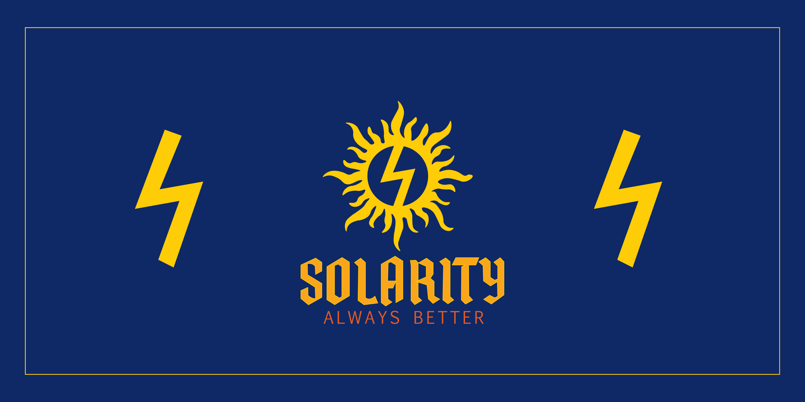

# Ata Turhan

**AI Engineer & Manager at HP · Founder & CEO of [Solarity AI](https://solarityai.com/)**  
Dallas, Texas, United States

I build local AI systems and lead product development, from model integration and evaluation to applications people can use. My work spans LLM serving, retrieval and agents, backend engineering, and the systems that help teams ship better products.

[Company](https://solarityai.com/) · [LinkedIn](https://www.linkedin.com/in/ataturhan21/) · [Writing](https://medium.com/@ataturhan21) · [Contact](mailto:ataturhan21@gmail.com)

## What I’m building

- **At HP:** local AI applications, model deployment, evaluation, and engineering leadership. Explore [Aware Care](https://github.com/ataturhan21/HP-Edge-AI-Demo-Aware-Care), a public demonstration of local inference on HP ZGX.
- **At Solarity AI:** AI-powered self-improvement apps and software for the teams building them. Explore our [mobile apps](https://solarityai.com/apps/), [engineering, management, and marketing products](https://solarityai.com/platform/), and [public company resources](https://github.com/Solarity-AI/public-resources).

## Selected engineering work

| Project | What to explore |
| --- | --- |
| **[Aware Care](https://github.com/ataturhan21/HP-Edge-AI-Demo-Aware-Care)** | Local AI healthcare navigation demo for HP ZGX Nano and Fury, with deployment tooling, synthetic scenarios, and model evaluation. Demonstration only. |
| **[Image Captioner](https://github.com/ataturhan21/ImageCaptioner-ConvNeXt_Transformer)** | PyTorch research notebook combining a ConvNeXt image encoder with a custom Transformer decoder for caption generation. |
| **[Alpha Trading Bot](https://github.com/ataturhan21/Alpha-Trading-Bot)** | Streamlit application for market data exploration, strategy development, backtesting, and parameter optimization. |
| **[Sigma Chatbot](https://github.com/ataturhan21/Sigma-Chatbot)** | University information chatbot using Streamlit, OpenAI, LangChain, and ChromaDB. A fork of the community’s [TOBB-GPT](https://github.com/TOBB-ETU-CS-Community/TOBB-GPT). |
| **[Optimized CNN-TA](https://github.com/ataturhan21/Optimized-CNN-TA)** | Research comparing technical analysis, machine learning, and deep learning approaches to trading strategies. |

More work: [all repositories](https://github.com/ataturhan21?tab=repositories) · [LeetCode solutions](https://github.com/ataturhan21/Leetcode-Solutions) · [Kaggle](https://www.kaggle.com/ataturhan)

## Technical focus

- **AI & ML:** Python, PyTorch, TensorFlow, Hugging Face, LangChain, LangGraph, MLflow.
- **Applications & data:** FastAPI, TypeScript, React, SQL, PostgreSQL.
- **Delivery:** Linux, Docker, GitHub Actions, automated testing, and performance evaluation.

## Background

B.Sc. in Artificial Intelligence Engineering from **TOBB ETÜ** and M.S. in Computer Science from **Maharishi International University**, with **4.0/4.0 GPAs and valedictorian honors in both programs**. Founder of the [TOBB ETÜ Computer Science Community](https://github.com/TOBB-ETU-CS-Community).

For AI engineering collaborations, product partnerships, or Solarity AI inquiries, connect on [LinkedIn](https://www.linkedin.com/in/ataturhan21/) or [email me](mailto:ataturhan21@gmail.com).

<!-- daily-rocket -->
**Always Better.** 🚀
